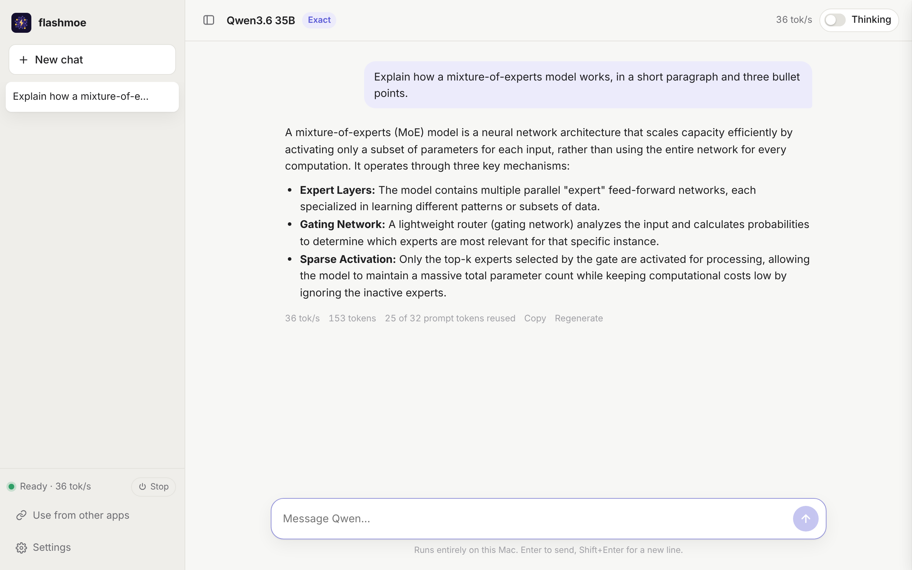
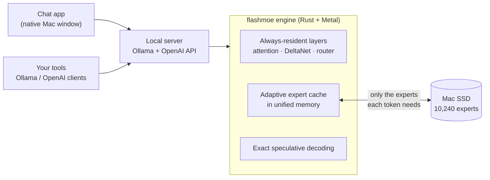

<p align="center">
  
</p>

<h1 align="center">flashmoe</h1>

<p align="center">
  <b>A 35-billion-parameter AI model, running privately on a 16 GB Mac.</b><br>
  Qwen3.6-35B-A3B at <b>~32 tokens/s</b>, token-for-token identical to the reference 4-bit model.<br>
  No cloud, no account, no Python. One app.
</p>

<p align="center">
  <a href="https://github.com/GabrielKH/flashmoe-app/releases/latest"><b>⬇ Download for macOS</b></a>
  &nbsp;·&nbsp; Apple silicon · macOS 14+ · 16 GB RAM · ~26 GB free disk
</p>

<p align="center">
  <picture>
    <source media="(prefers-color-scheme: dark)" srcset="assets/screenshot-dark.png">
    
  </picture>
</p>

---

## The idea

A 35B model needs about 20 GB even at 4 bits. A base MacBook has 16 GB, shared between macOS, your apps and the GPU. Ordinary runtimes either refuse, or swap until the machine grinds to a halt.

flashmoe takes a different route. Qwen3.6-35B-A3B is a **mixture-of-experts** model: for each token, only a handful of its 10,240 expert networks do any work, about 3B parameters out of 35B. So flashmoe keeps the small, always-used part of the model in memory and treats the Mac's SSD as an extension of RAM, pulling in only the experts each token needs.

Done naively, that gives about 15 tokens/s. flashmoe gets **twice that**, with output that is bit-for-bit the same as the model running fully in memory.

## How fast

Measured on an **M4 Mac with 16 GB RAM and a 256 GB SSD**: decode speed, averaged over English, code, multilingual and maths prompts.

| Mode | Speed | Output |
|---|---:|---|
| **Exact** (default) | **~32 tok/s** | Token-for-token identical to the reference 4-bit model |
| **Fast** | **~40 tok/s** | Compressed experts. Same test scores, small differences in wording |
| Plain SSD streaming, for comparison | ~15 tok/s | Identical |
| Loading the whole model into RAM | doesn't fit in 16 GB | — |

Chat turns reuse the work already done on the conversation, so a follow-up question starts answering almost immediately.

## How good

Same questions, same settings (greedy decoding, thinking off), run through the app's own engine.

| Benchmark | Exact | Fast |
|---|---:|---:|
| **GSM8K** · grade-school maths (100) | **90.0** | **91.0** |
| **MMLU** · knowledge, sampled across subjects (210) | **79.5** | **79.5** |
| **HumanEval** · Python coding, run against the tests (50) | **100.0** | **100.0** |
| **Tool calling** · function calls in 7 languages (30) | **100.0** | **96.7** |
| Malformed tool calls | 0 | 0 |

Exact mode is the published model's own quality by construction. These scores confirm that the engine around it doesn't lose anything. Fast mode matches it on reasoning, knowledge and code, and missed one of the 30 tool calls (a Japanese request).

## What's inside



A few of the ideas behind the speed, without the full recipe:

- **Memory that learns what matters.** The cache tracks which experts the model actually uses as a conversation goes on, and keeps those in RAM. About 97–98% of expert reads never touch the SSD.
- **Looking one step ahead.** The model's own routing signal predicts which experts the *next* layer will want, so the SSD is already fetching them while the GPU works.
- **Several tokens per step, with no loss.** Qwen3.6 ships with a small multi-token-prediction head. flashmoe drafts tokens with it and verifies them in a single pass, using a provably exact acceptance rule, so the output distribution doesn't change at any temperature.
- **The GPU decides on its own.** Routing happens on the GPU, layer after layer, with no round trips to the CPU.
- **Hand-written Metal kernels.** Matrix and recurrence kernels are written around the model's exact shapes and Apple's unified memory, so each weight read from memory is reused as much as possible.
- **Trellis-coded compression** (Fast mode). Experts are re-encoded at about 3 bits per weight with a lattice-style trellis code, while the experts used most stay at full 4-bit precision.

Every speed-up was kept only if it passed two checks: the GPU result matches an independent CPU reference, and the real model's output matches the reference implementation token for token.

## Use it from other apps

flashmoe runs a local server that speaks both the **Ollama** and **OpenAI** APIs, so most tools work by changing one URL.

| | URL |
|---|---|
| Ollama API | `http://127.0.0.1:11435` |
| OpenAI API | `http://127.0.0.1:11435/v1` |

```bash
curl http://127.0.0.1:11435/api/chat -d '{
  "model": "qwen3.6-35b-a3b",
  "messages": [{"role": "user", "content": "Why is the sky blue?"}],
  "think": false
}'
```

```python
from openai import OpenAI
client = OpenAI(base_url="http://127.0.0.1:11435/v1", api_key="unused")
reply = client.chat.completions.create(model="qwen3.6-35b-a3b",
    messages=[{"role": "user", "content": "Explain mixture-of-experts in two sentences."}])
print(reply.choices[0].message.content)
```

The server supports streaming, tool and function calls, thinking on or off (`think` in Ollama, separate `reasoning_content` in OpenAI), sampling options, an optional API key, and CORS for browser apps. A menu-bar icon keeps it running while the window is closed.

## Install

1. Download the DMG from [Releases](https://github.com/GabrielKH/flashmoe-app/releases/latest), open it and drag **flashmoe** to Applications.
2. Open flashmoe. The first time, it offers to download Qwen3.6-35B-A3B from Hugging Face (about 21 GB) and prepares it as it downloads. If the connection drops, it resumes.
3. Chat. After setup, everything runs offline, and nothing you type leaves your Mac.

**Settings** at a glance: Exact or Fast, the memory given to the expert cache, a Thinking switch, style and system prompt. Under *Advanced*: sampling, context length, speculative decoding, port, network access and an API key.

## FAQ

**Does it work on 8 GB Macs?** Not yet. 16 GB is the minimum, and more RAM makes it faster, because more experts fit in the cache.

**Will it wear out my SSD?** No. It only *reads* from the SSD, and reads don't wear flash storage. Writes happen once, during setup.

**Is it really identical to the original model?** In Exact mode, yes: for the same prompt and settings it produces the same tokens as the reference 4-bit model (`mlx-community/Qwen3.6-35B-A3B-4bit`). This was verified on the real model, and every engine change has to keep it true.

**Other models?** Coming. The same approach works for other mixture-of-experts models, and support for more Hugging Face MoE models is the next big step.

## License

flashmoe is free to download and use. It is **not open source**. See [LICENSE](LICENSE). The model weights are Qwen3.6-35B-A3B by the Qwen team (Alibaba Cloud), released under Apache 2.0. They are downloaded directly from Hugging Face and not redistributed here. Third-party software notices are in [NOTICES.md](NOTICES.md).
